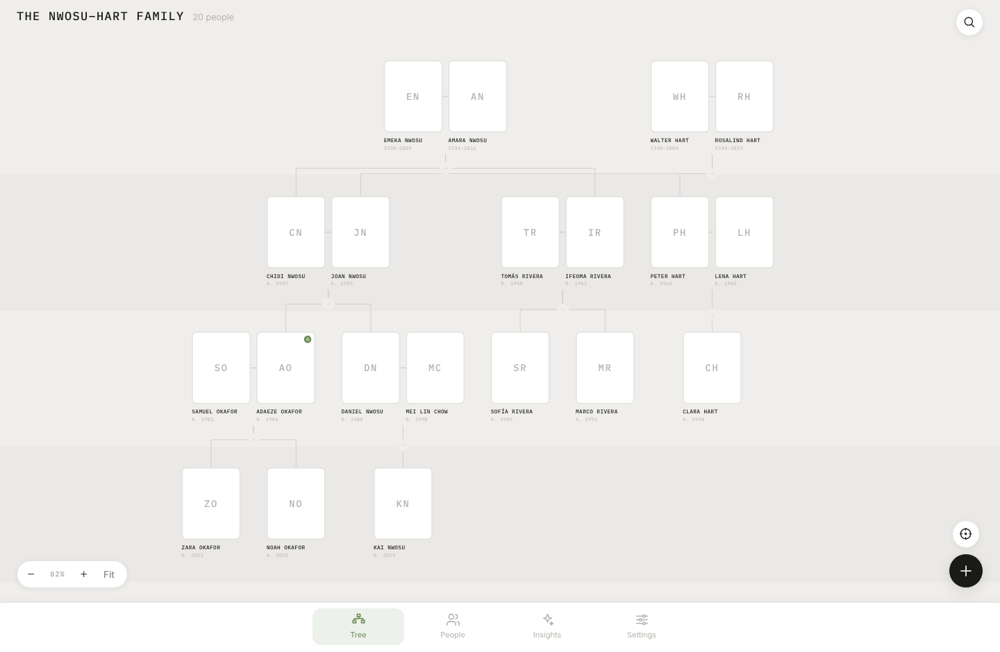
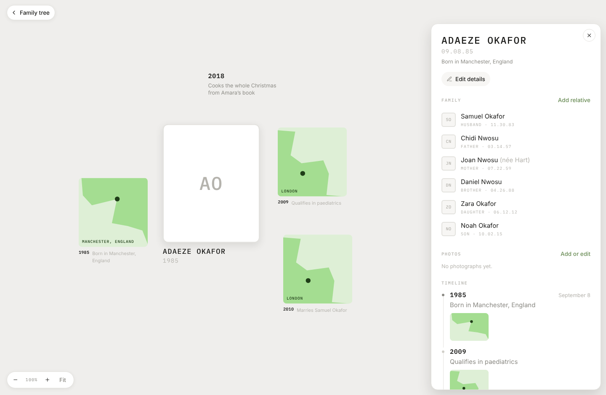
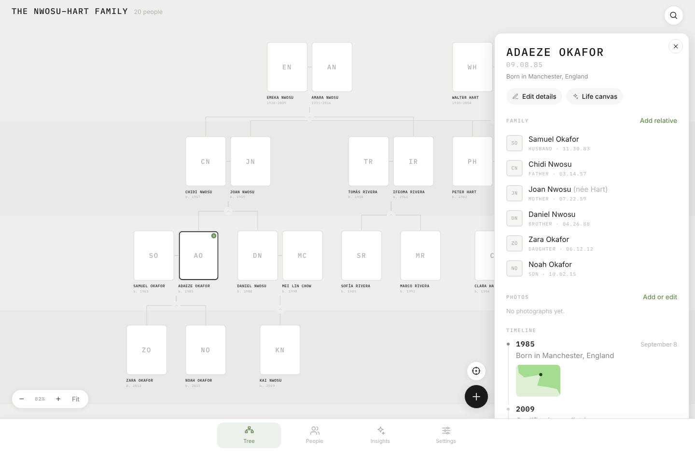
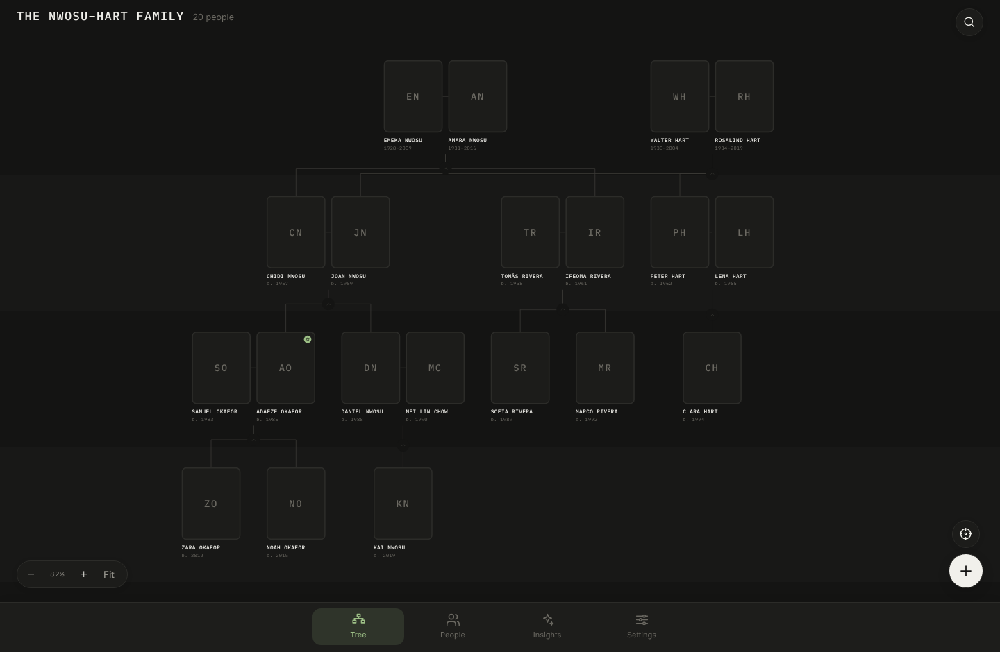

# Fams

A family tree app for web, iOS and Android, built with Expo and React Native.

Most family tree software is a database with a diagram bolted on. Fams starts
from the diagram, and treats the archive as the point: photographs are the
cards, names and dates are set in letterspaced monospace, and the only colour
on the page is the one in the pictures.

There are two canvases. The tree answers **who** — generations, couples,
branches you can collapse. A person's life canvas answers **what happened** —
their photographs, places and moments strewn around a portrait.

<p align="center">
  
</p>
<p align="center">
  
  
</p>
<p align="center">
  
</p>

## What it does

- **Two canvases, one interaction.** Pan and pinch on device; scroll to pan and
  ⌘/Ctrl-scroll to zoom on the web. Double-tap toggles overview and detail, and
  a zoom register sits bottom-left with a Fit button.
- **A life canvas per person.** Their photographs, the places they lived and the
  moments they are remembered for, scattered around a portrait — stable,
  overlap-free, and generated from the record rather than hand-arranged.
- **A detail panel** that docks to the right on desktop and becomes a sheet on a
  phone: family with relationships and dates, the album, and a timeline that
  brackets recorded moments with birth and death.
- **A layout that holds up.** Generation rows, couples drawn side by side,
  parents centred over their children, and sibling bars staggered so two
  families in the same row never merge into one line. It handles people who
  marry in, second partnerships, and children of different unions.
- **Collapse a branch** to fold away descendants, with a badge showing how many
  people are hidden — counting only those with no other route onto the canvas.
- **Focus one person's lineage** to cut a large tree down to their ancestors,
  descendants, siblings and partners.
- **Relationships in plain English.** Pick who you are and everybody else is
  labelled from your point of view: "your grandmother", "your 2nd cousin once
  removed", "your sister-in-law", "your step-father".
- **Partial dates.** `1948`, `1948-03` and `1948-03-11` are all valid, and ages,
  lifespans and birthday countdowns degrade to whatever precision is known.
- **Insights.** Generation depth, couples, upcoming birthdays, longest life,
  surname distribution.
- **Abstract place tiles.** Real cartography needs a tile server and a key; what
  the eye wants is "somewhere on a coast", so each place generates its own
  coastline deterministically from its name.
- **Your data stays yours.** Everything is stored on the device. Export is plain
  JSON, and import accepts it back.

## Running it

```bash
npm install
npm start          # then press i, a or w
```

```bash
npm run ios        # iOS simulator
npm run android    # Android emulator
npm run web        # browser
npm run build:web  # static web build into dist/
```

Checks:

```bash
npm run typecheck  # app and test sources
npm run lint
npm test           # layout, relations and date logic
```

## How it is put together

```
src/
  app/               expo-router routes
    (tabs)/          tree · people · insights · settings
    person/[id]      profile
    life/[id]        the life canvas
    edit/[id]        create and edit ("new" creates)
  components/        UI primitives, sheets, and the tree canvas
  lib/
    layout.ts        the tree layout engine
    scatter.ts       the life-canvas scatter engine
    story.ts         timelines, albums and places derived from a person
    relations.ts     derived family relationships and kinship naming
    dates.ts         partial-date parsing, ages, lifespans
    transfer.ts      JSON import and export
  store/             zustand store, persisted through AsyncStorage
  theme/             design tokens and the theme provider
tests/               node:test suites over the pure modules
```

### The layout engine

`src/lib/layout.ts` is the heart of the app and is deliberately free of runtime
imports so it can be tested and reasoned about on its own.

1. **Generations.** Each person sits one row below their deepest parent, and
   partners are pulled down to share a row. Both rules only ever increase a
   generation, so the fixed-point loop terminates — including on malformed data
   with a parent cycle.
2. **Units.** Partners are grouped into a unit and drawn side by side. A person
   joins the unit of the first partner who claims them, so everybody is placed
   exactly once even when the graph is tangled.
3. **Placement.** A Reingold–Tilford style post-order pass: children are laid
   out first, the parents are centred over them, and when that would collide
   with a sibling the whole child block is pushed right instead of overlapping.
4. **Links.** Partner links, and rounded elbows from each couple down to each
   child, with the horizontal bars staggered across three lanes per row.

A family tree is a DAG rather than a tree — two parents per child, people who
marry in — so the traversal tracks what has already been placed and gives any
unreachable couple its own slot.

### The scatter engine

`src/lib/scatter.ts` arranges a life canvas. Cards are tried along a golden
spiral at growing radii and the first slot that collides with nothing wins, so
the result looks strewn across a table but never overlaps. Positions are seeded
from each card's id, which means the same life always lays out the same way —
the arrangement becomes something you can remember your way around.

### Data model

A `Person` carries `parentIds` and `partnerIds`; unions (married, partners,
divorced, …) are stored separately and keyed by the two partner ids. Everything
else is derived, which keeps edits local: adding a child never has to rewrite a
family record.

### Design language

Near-monochrome paper grey, a single muted sage for anything actionable, and
IBM Plex Mono in letterspaced uppercase for every name, date and section label.
Cards are the photograph itself; somebody with no photograph gets a pale card
with their initials, so the gaps in an archive are visible rather than papered
over. Connectors are unrounded hairlines, and generations are separated by
stripes you feel more than see.

## Built with

Expo SDK 57 · React Native 0.86 · expo-router · react-native-reanimated ·
react-native-gesture-handler · react-native-svg · zustand · IBM Plex Mono
